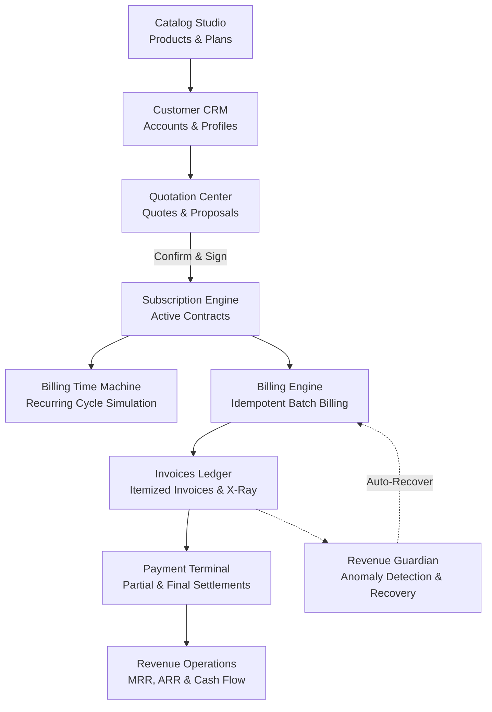
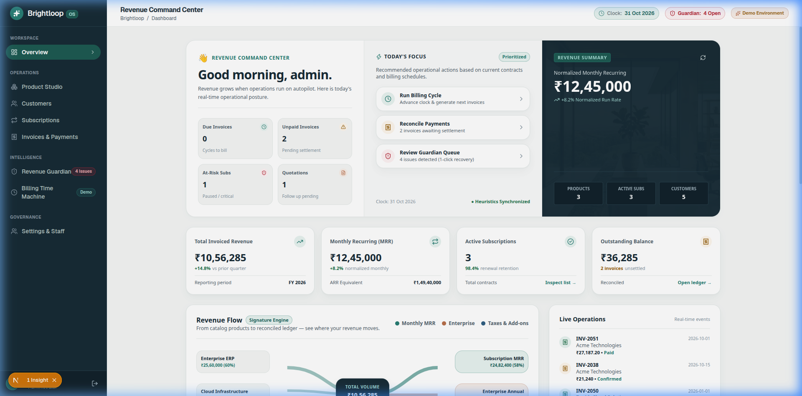
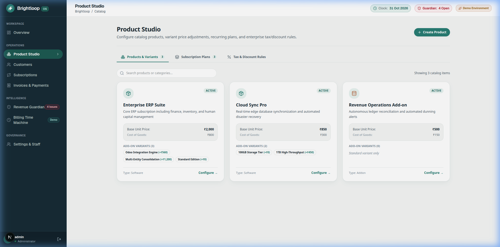
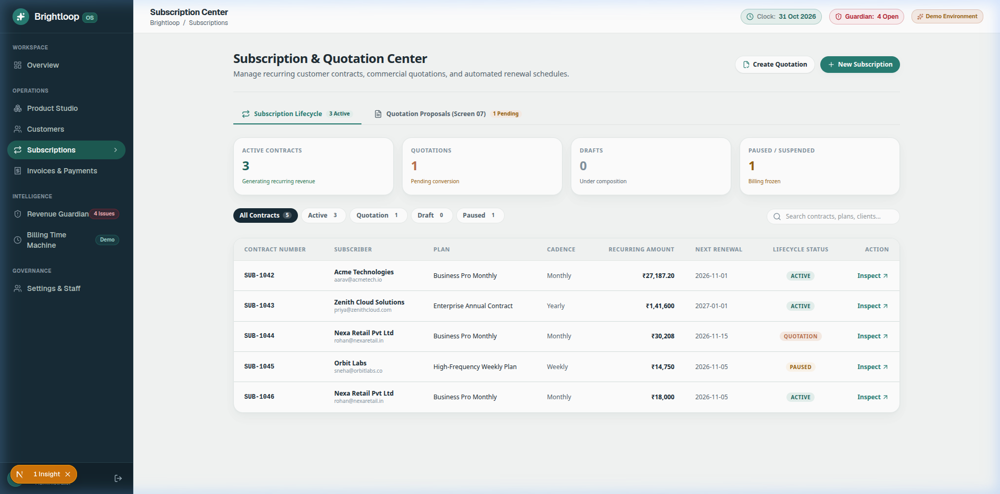
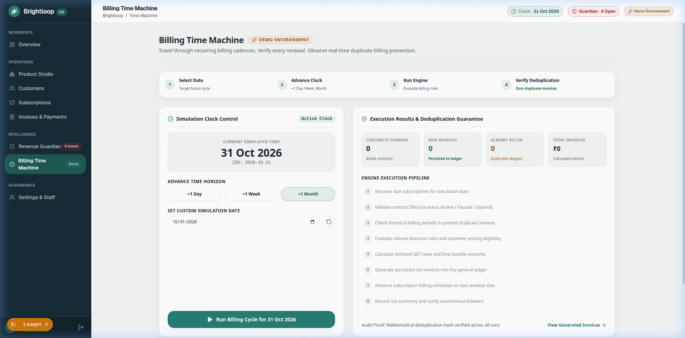
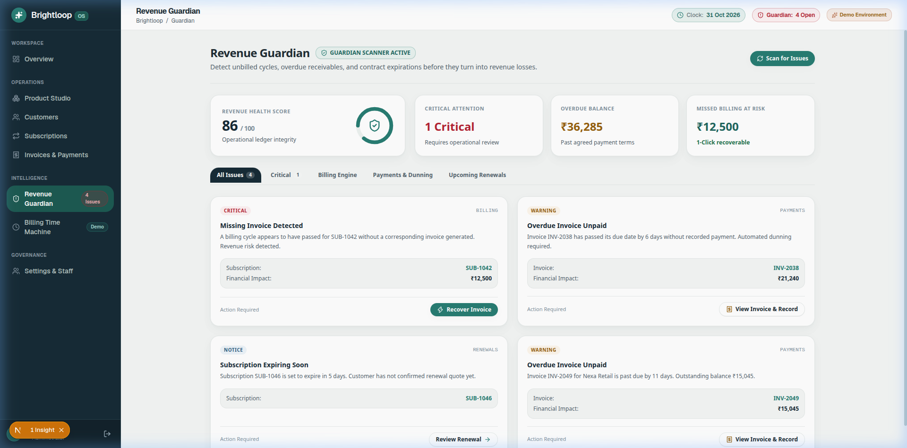
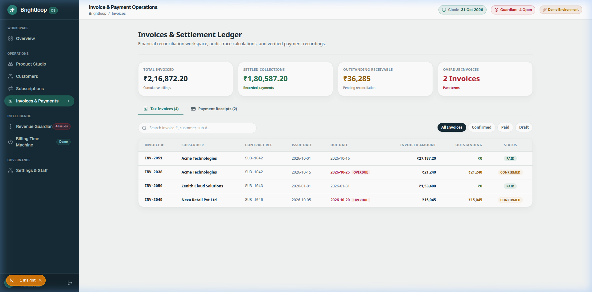
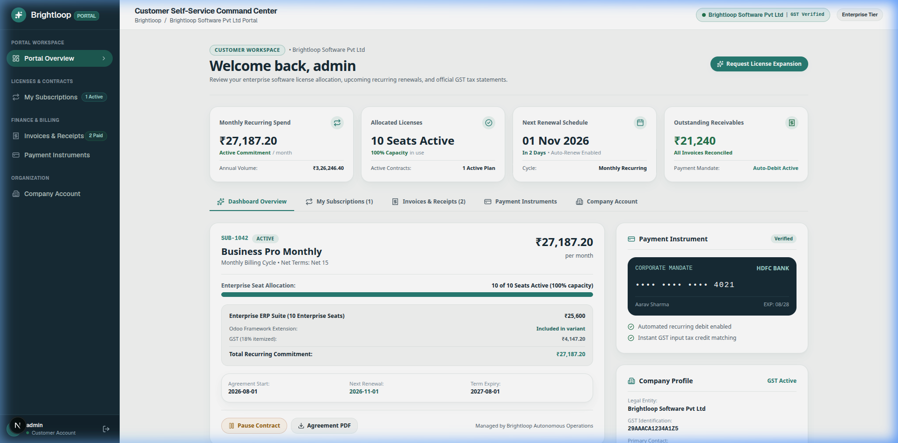
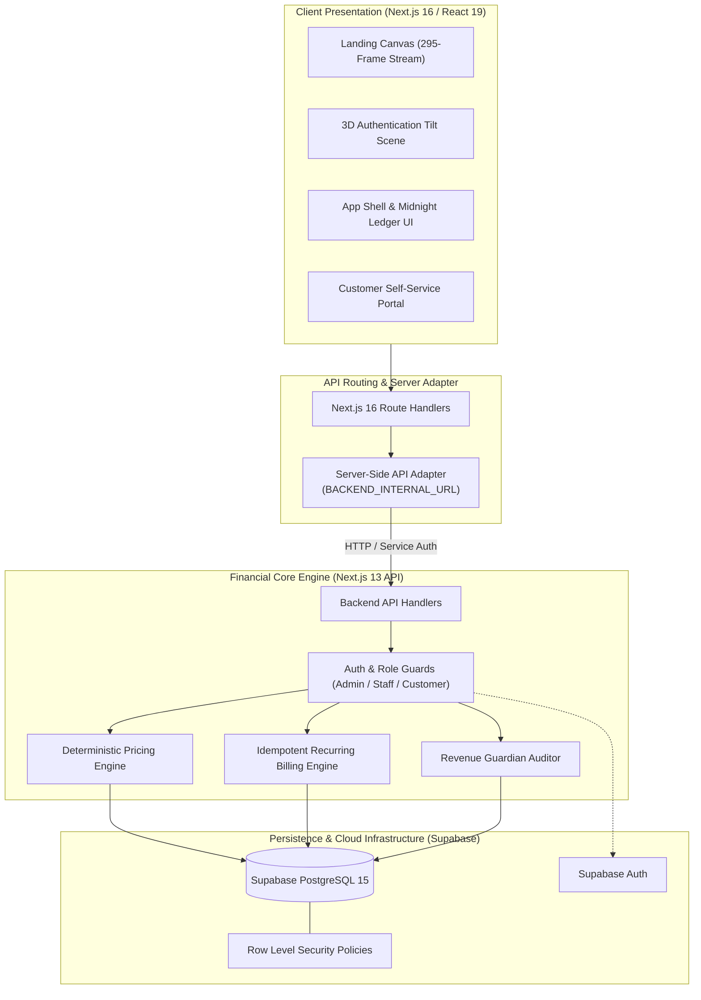

<h1 align="center">BRIGHTLOOP OS</h1>

<p align="center">
  <strong>Intelligent Subscription Management & Revenue Operations Platform</strong><br>
  <em>From contract quotation and subscription creation to automated recurring billing and revenue recovery — one unified operating system.</em>
</p>

<p align="center">
  <a href="https://brightloop-subscription-system.vercel.app/" target="_blank">
    
  </a>
</p>

<p align="center">
  🚀 <strong><a href="https://brightloop-subscription-system.vercel.app/">OPEN BRIGHTLOOP OS — LIVE DEMO</a></strong>
</p>

<p align="center">
  
  
  
  
  
  
  
  
</p>

---

## ⚡ Evaluate Brightloop OS in 3 Minutes

Follow this quick walkthrough to experience the end-to-end subscription and revenue lifecycle:

1. **Launch the Application**: Open the **[Live Demo](https://brightloop-subscription-system.vercel.app/)** and click **Enter Platform** or **Sign In** (use any email or default executive demo persona).
2. **Inspect Financial Metrics (`/dashboard`)**: View real-time aggregated metrics including Monthly Recurring Revenue (MRR), Annual Run Rate (ARR), collection efficiency, and invoice aging.
3. **Explore Catalog Studio (`/catalog`)**: Review multi-tiered SaaS offerings, product variants with price adjustments, billing cadences (monthly/yearly), active tax rules (GST 18%), and promotional discount rules.
4. **Trigger Billing Time Machine (`/time-machine`)**: 
   - Select a future simulation date (e.g. `2026-11-30`).
   - Click **Simulate & Run Billing** to watch the autonomous 8-stage recurring billing engine evaluate contracts and generate invoices.
   - Run the simulation again for the same date to verify **idempotent duplicate invoice suppression**.
5. **Recover Lost Revenue in Guardian (`/guardian`)**: Inspect anomalies detected across the revenue pipeline (missing invoice cycles, overdue aging). Click **Recover** on any anomaly to trigger recovery through the unified billing engine.
6. **Inspect Invoice X-Ray (`/invoices`)**: Click on any invoice to open the **Invoice X-Ray** modal, inspecting exact integer minor-unit calculations, variant price adjustments, applied discounts, and tax breakdowns.

---

## The Problem

Modern SaaS and subscription businesses face systemic revenue leakage and operational bottlenecks due to fragmented tooling:

* **Disjointed Workflows**: Product catalogs, sales quotations, active contracts, and invoices live in disconnected silos.
* **Complex Billing Cadences**: Managing prorated charges, add-on variant pricing, dynamic discounts, and localized tax rules leads to calculation errors and floating-point rounding drift.
* **Silent Revenue Leakage**: Contract renewals fail silently, invoices are missed during billing cycle rollovers, and overdue invoices slip past finance teams.
* **Duplicate Invoice Risk**: Rerunning batch billing cycles or retrying failed operations often leads to catastrophic double-invoicing.
* **Opaque Invoicing**: Customers and sales teams lack visibility into how final invoice amounts are calculated from base prices, variants, discounts, and taxes.

## Our Solution

**Brightloop OS** is a unified, high-reliability Subscription Management and Revenue Operations Platform. It orchestrates the entire subscription journey within an idempotent, transaction-safe architecture:



---

## Signature Innovations

### ⏳ 1. Billing Time Machine (Autonomous Billing Simulation)
Evaluators can simulate future billing dates to verify automated recurring invoicing without waiting for calendar days to elapse:
* **Deterministic Advancement**: Advance the simulation clock across daily, weekly, monthly, and annual subscription cycles.
* **Zero Duplicate Guarantee**: Enforces idempotent billing via database-level uniqueness constraints on `(subscription_id, period_start)`. Re-running billing for an already-billed period cleanly reports and suppresses duplicate creation.
* **Animated 8-Stage Execution**: Visualizes real-time batch processing stages from subscription eligibility filtering to tax calculation and ledger emission.

### 🛡️ 2. Revenue Guardian (Autonomous Revenue Anomaly Recovery)
Revenue Guardian continuously audits the billing pipeline to identify and remediate revenue leakage:
* **Pipeline Auditing**: Detects missed recurring cycles, overdue invoices, expiring contracts, and unbilled active subscriptions.
* **Unified Recovery Pipeline**: Unlike naive mock generators, clicking **Recover** executes the production billing engine, creating valid, auditable invoices linked to customer contracts and advancing billing dates safely.

### 🔎 3. Invoice X-Ray (Transparent Integer Pricing Breakdown)
Every invoice provides a glassmorphic **Invoice X-Ray** modal detailing exact monetary line items calculated in minor units (paise) with zero floating-point drift:

$$\text{Final Total} = (\text{Subtotal} - \text{Discount}) + \text{Tax}$$

```text
Product Base Price:         ₹2,000.00   ( 200000 paise)
Variant Adjustment (Odoo):   + ₹560.00   (  56000 paise)
Unit Contract Price:        ₹2,560.00   ( 256000 paise)
Contract Quantity:                 10
--------------------------------------------------------
Contract Subtotal:         ₹25,600.00   (2560000 paise)
Promotional Discount (10%): -₹2,560.00   (-256000 paise)
--------------------------------------------------------
Net Taxable Amount:        ₹23,040.00   (2304000 paise)
GST Tax (1800 bp / 18%):   + ₹4,147.20   (+ 414720 paise)
========================================================
FINAL INVOICE TOTAL:       ₹27,187.20   (2718720 paise)
```

---

## Core Capabilities

| Module | Features & Capabilities |
|---|---|
| **Subscription Lifecycle** | Customer onboarding, multi-variant products, quotation creation, quotation confirmation, instant contract activation, pause/resume, and renewal workflows. |
| **Automated Billing Engine** | Daily, weekly, monthly, and yearly recurring intervals; deterministic pricing snapshots; payment terms calculation (Net 15/30); and automated invoice generation. |
| **Ledger & Settlement** | Multi-status invoice tracking (`draft`, `confirmed`, `paid`, `canceled`), split and partial payment recording, outstanding balance updates, and payment audit logs. |
| **Financial Intelligence** | Real-time calculation of MRR, ARR, collection rates, aging receivables, cash collections, and monthly revenue trends. |
| **Customer Portal (`/portal`)** | Self-service portal where customers view active contracts, download invoices, record payments, and inspect subscription line items. |
| **Operator Access Controls** | Role-based permission enforcement distinguishing `admin`, `staff`, and `customer` roles with strict cross-customer data isolation. |

---

## Visual Showcase

<div align="center">
  <h3>Operational Dashboard & Financial KPI Tracking</h3>
  
</div>

<br />

<div align="center">
  <table width="100%">
    <tr>
      <td width="50%" align="center">
        <strong>Product & Pricing Studio</strong><br />
        
      </td>
      <td width="50%" align="center">
        <strong>Subscription Contracts & Quotations</strong><br />
        
      </td>
    </tr>
    <tr>
      <td width="50%" align="center">
        <strong>Billing Time Machine Simulation</strong><br />
        
      </td>
      <td width="50%" align="center">
        <strong>Revenue Guardian Anomaly Recovery</strong><br />
        
      </td>
    </tr>
    <tr>
      <td width="50%" align="center">
        <strong>Invoice Ledger & Settlement</strong><br />
        
      </td>
      <td width="50%" align="center">
        <strong>Self-Service Customer Portal</strong><br />
        
      </td>
    </tr>
  </table>
</div>

---

## System Architecture

Brightloop OS separates presentation and high-performance client rendering from financial business logic and database persistence:



---

## Technology Stack

| Layer | Technologies & Libraries | Version | Purpose |
|---|---|---|---|
| **Frontend Framework** | [Next.js](https://nextjs.org/) (Turbopack) | `16.4.3` | High-performance React framework with Partial Prerendering |
| **UI Library** | [React](https://react.dev/) | `19.3.0` | Modern component rendering and concurrency |
| **Styling** | [Tailwind CSS](https://tailwindcss.com/) | `v4` | Midnight Ledger design system and CSS tokens |
| **Charts & Data** | [Recharts](https://recharts.org/) | `3.10.1` | Financial analytics, revenue breakdown, and trend graphs |
| **Icons & Feedback** | Lucide React, Sonner | `1.65.0` | Accessible iconography and toast notifications |
| **Backend API** | Next.js App Router | `13.5.6` | Modular REST API Route Handlers |
| **Database** | [PostgreSQL](https://www.postgresql.org/) via [Supabase](https://supabase.com/) | `15` | Relational tables, unique constraints, and schema persistence |
| **Authentication** | Supabase Auth | `2.118.0` | JWT validation and profile role verification |
| **Schema Validation** | [Zod](https://zod.dev/) | `3.25.76` | Runtime payload type safety and schema validation |
| **Testing** | [Vitest](https://vitest.dev/) | `1.6.1` | Automated unit, security, and integration testing |
| **Deployment** | [Vercel](https://vercel.com/) | Edge/Serverless | Global cloud hosting and continuous deployment |

---

## Engineering Quality & Reliability

* **100% Passing Automated Tests**: 55 unit, security, and integration tests passing in Vitest:
  ```text
  Test Files  10 passed (10)
       Tests  55 passed (55)
    Duration  2.78s
  ```
* **Strict Customer Isolation**: Multi-tenant data segregation verified via unit security tests. Requests to access another customer's invoice or records are rejected with `403 FORBIDDEN`.
* **Zero Floating-Point Arithmetic**: All monetary fields (`sales_price_minor`, `subtotal_minor`, `tax_minor`, `total_minor`) are stored and computed in integer minor units (paise / cents), preventing rounding loss.
* **Idempotent Billing Runs**: Guaranteed duplicate prevention via unique period constraints. Re-executing billing for an identical subscription period safely skips invoice creation.
* **Dual-Engine Workspace Symlink**: Clean workspace architecture allowing independent backend development on `:3001` and frontend development on `:3000`.

---

## Repository Structure

```text
brightloop/
├── docs/
│   ├── assets/                          # Captured production screenshots
│   └── API_CONTRACT.md                  # Comprehensive REST API specifications
├── src/
│   ├── app/api/                         # Next.js 13 Backend Route Handlers (17 endpoints)
│   ├── backend/
│   │   ├── auth/                        # requireAuth, requireStaff, requireAdmin guards
│   │   ├── billing/                     # Deterministic pricing & recurring billing engine
│   │   ├── database/                    # Supabase client & connection wrappers
│   │   ├── services/                    # Domain services (invoices, subscriptions, guardian)
│   │   └── validation/                  # Zod validation schemas
│   ├── shared/types/                    # Domain entity definitions
│   └── frontend/                        # Next.js 16 Frontend Application
│       ├── public/                      # Assets, 295-frame landing stream, images
│       ├── src/
│       │   ├── app/                     # Pages: (admin) dashboard, catalog, invoices, etc.
│       │   ├── components/              # UI components, 3D auth scene, shell, canvas
│       │   ├── lib/                     # Server-side API adapter, auth context, fixtures
│       │   └── types/                   # Frontend view types
│       ├── next.config.mjs              # Turbopack & Tailwind v4 configuration
│       └── vercel.json                  # Frontend Vercel deployment configuration
├── supabase/
│   └── migrations/                      # PostgreSQL DDL migrations (tables, indexes, RLS)
├── tests/
│   ├── integration/                     # End-to-end billing workflow tests
│   ├── security/                        # Authorization & customer isolation tests
│   └── unit/                            # Pricing, subscriptions, tax, and plan tests
├── package.json                         # Backend dependencies & scripts
├── vercel.json                          # Backend Vercel deployment configuration
└── README.md                            # Documentation
```

---

## Local Development Setup

### Prerequisites
* **Node.js**: v18.17+ or v20+ (Node.js v24 tested)
* **npm**: v9+

### 1. Clone & Install
```bash
git clone https://github.com/MdAsif-Ai/Brightloop_Subscription_system.git
cd Brightloop_Subscription_system

# Install backend dependencies
npm install

# Install frontend dependencies
cd src/frontend && npm install && cd ../..
```

### 2. Environment Configuration
Create `.env.local` in the root repository (and optionally in `src/frontend/.env.local`):
```env
NEXT_PUBLIC_SUPABASE_URL=https://your-project.supabase.co
NEXT_PUBLIC_SUPABASE_ANON_KEY=your-supabase-anon-key
SUPABASE_SERVICE_ROLE_KEY=your-supabase-service-role-key
BACKEND_INTERNAL_URL=http://localhost:3001
APP_MODE=real
```

### 3. Run Applications
```bash
# Terminal 1: Start Backend API Server (Port 3001)
npm run dev:backend

# Terminal 2: Start Frontend Application (Port 3000)
cd src/frontend && npm run dev
```

* **Frontend**: [`http://localhost:3000`](http://localhost:3000)
* **Backend API**: [`http://localhost:3001`](http://localhost:3001)

### 4. Run Test Suite
```bash
npm test
```

---

## API Overview

Detailed request and response schemas are documented in [**docs/API_CONTRACT.md**](docs/API_CONTRACT.md).

| Category | Route | Methods | Description |
|---|---|---|---|
| **Products** | `/api/products` | `GET`, `POST`, `PATCH` | Manage multi-variant catalog products |
| **Plans** | `/api/plans` | `GET`, `POST`, `PATCH` | Subscription cadence and trial configuration |
| **Customers** | `/api/customers` | `GET`, `POST`, `GET :id` | Customer accounts and billing addresses |
| **Quotations** | `/api/quotations` | `GET`, `POST`, `POST :id/confirm` | Create quotes and convert to active subscriptions |
| **Subscriptions** | `/api/subscriptions` | `GET`, `POST`, `POST :id/transition` | Contract lifecycle (activate, pause, resume, close) |
| **Invoices** | `/api/invoices` | `GET`, `GET :id` | Itemized invoice records with pricing traces |
| **Payments** | `/api/payments` | `GET`, `POST` | Record partial and full invoice payments |
| **Billing** | `/api/billing/run` | `GET`, `POST` | Execute recurring batch billing runs |
| **Guardian** | `/api/guardian` | `GET`, `POST /recover` | Detect revenue anomalies and trigger recovery |
| **Analytics** | `/api/analytics` | `GET` | Aggregated MRR, ARR, and collection KPIs |

---

## How Brightloop OS Addresses the Challenge

| Requirement | Implementation in Brightloop OS | Verification Status |
|---|---|---|
| **Product & Variant Catalog** | Dynamic catalog with price adjustments, base fees, and active statuses | Verified (Unit tests + UI) |
| **Flexible Subscription Cadence** | Daily, weekly, monthly, and yearly recurring intervals | Verified (Vitest unit tests) |
| **Quotation-to-Contract Pipeline** | Draft quotes convertible to confirmed and active subscriptions | Verified (Integration tests) |
| **Contract Lifecycle State Machine** | Strict transitions: `draft` → `confirmed` → `active` ⇄ `paused` → `closed` | Verified (`subscriptions.transition.test.ts`) |
| **Transparent Invoicing** | Glassmorphic Invoice X-Ray with itemized base, variant, discount, and tax lines | Verified (Live in browser) |
| **Idempotent Recurring Billing** | Zero duplicate invoice generation via period uniqueness constraints | Verified (Time Machine simulation) |
| **Revenue Anomaly Remediation** | Revenue Guardian audits missed cycles and automatically recovers lost revenue | Verified (Guardian recovery flow) |
| **Customer Data Isolation** | Multi-tenant isolation preventing cross-account access via role-based guards | Verified (`authorization.test.ts`) |

---

<p align="center">
  <strong>Brightloop OS</strong> — Designed & Engineered for the Hackathon.<br>
  Built with Next.js, React, Tailwind CSS, Supabase PostgreSQL, and Vercel.
</p>
